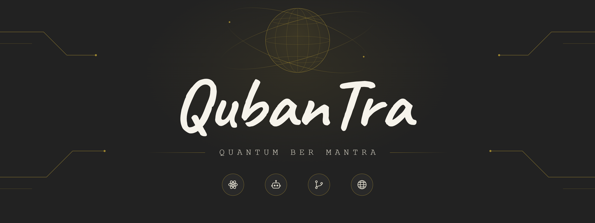

 

## Tentang

**QubanTra** adalah ruang kerja untuk riset, otomasi, dan pengembangan perangkat lunak. Semua proyek di sini dibangun dengan prinsip yang sama: rapi, terdokumentasi, dan mudah dipakai ulang oleh orang lain.

## Fokus

| Bidang | Cakupan |
| --- | --- |
| Riset | Eksperimen dan catatan seputar komputasi kuantum |
| Bot dan otomasi | Bot, skrip, dan alur kerja yang mengurangi pekerjaan berulang |
| Open source | Kode terbuka dengan lisensi yang jelas dan dokumentasi yang memadai |
| Web | Aplikasi web, API, dan layanan pendukungnya |

## Proyek

| Proyek | Deskripsi |
| --- | --- |
| [nama-proyek](https://github.com/qubantra/nama-proyek) | Satu kalimat tentang fungsi proyek ini |
| [nama-proyek](https://github.com/qubantra/nama-proyek) | Satu kalimat tentang fungsi proyek ini |

## Berkontribusi

Kontribusi diterima melalui issue dan pull request. Sebelum mengirim perubahan, baca `README` dan `CONTRIBUTING` pada repositori yang bersangkutan, lalu jelaskan masalah atau tujuan perubahannya secara singkat.

## Kontak

- Situs: [alamat-situs](https://alamat-situs)
- Surel: [alamat@surel.com](mailto:alamat@surel.com)
